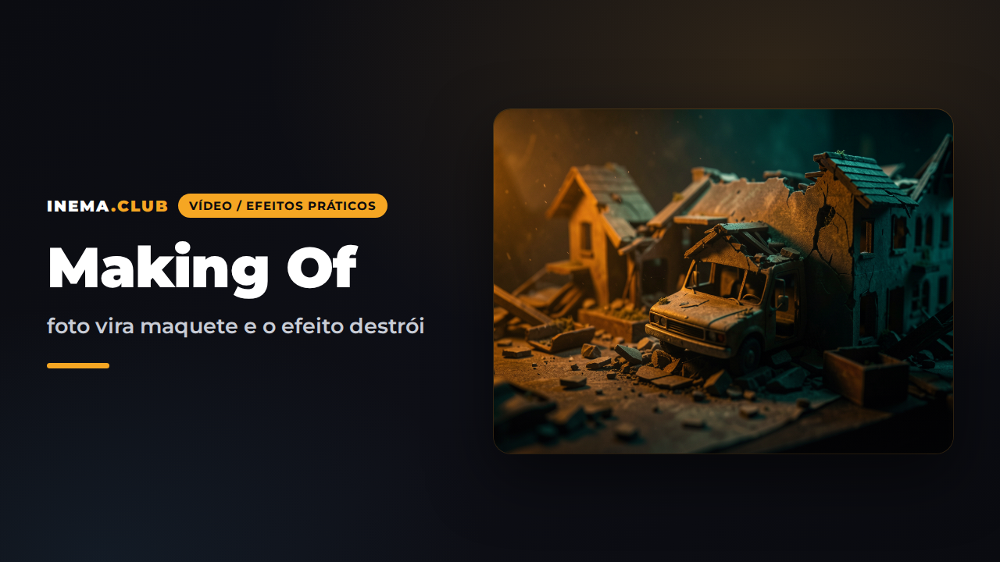
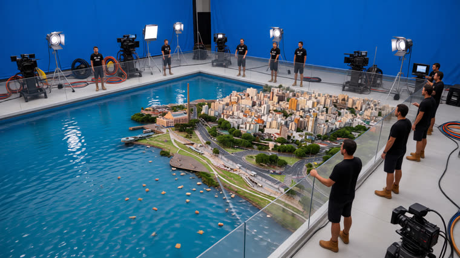
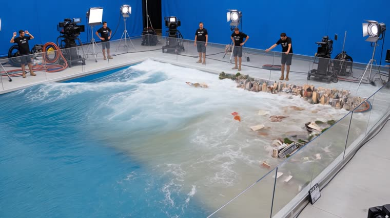

# video-making-of-skill

**🇧🇷 [Português](README.md) · 🇺🇸 [English](README.en.md) · 🇪🇸 [Español](README.es.md)**



## 📖 User guide

Complete guide (landing page + step-by-step): **https://inematds.github.io/video-making-of-skill/guia/en/**

---

Turns **a reference photo** into an ultra-realistic *behind-the-scenes* video of a practical effect: the subject in the photo becomes a **miniature model** inside a studio rig (wave tank, shake table, fire bars…), and the effect destroys the model while the crew films from a distance.

| keyframe A — the assembled miniature | the result — the wave destroying it |
|---|---|
|  |  |

The two clips that worked, both 15s and generated from the same photo — [recipe B](guia/assets/b-kling.mp4)
(single shot, faithful to the guide) and [v2 variant](guia/assets/v2-kling.mp4) (multi-shot with the studio reveal).
Watch them in the [guide](https://inematds.github.io/video-making-of-skill/guia/en/#video).

Based on the AVCC guide to miniature destruction in a wave tank (`doc/`), corrected based on what was **measured** while generating ~15 real clips across two providers.

## The key discovery

> The video generator must receive the **already assembled miniature** as its first frame — not the reference photo.

Controlled test, same full guide prompt, same source image:

| | A — raw photo | B — miniature as the starting frame |
|---|---|---|
| opening | the real city, intact | studio, faithful miniature |
| destruction | buildings **dissolve in place**, into cubes | buildings **break** and are dragged away |
| wave | none | comes from the open-water side, moving laterally across |
| ending | empty tank (without ever showing the miniature or wave) | scraped base + debris |

With the raw photo, the model understands *"transform this photo"*, not *"build a miniature of this"* —
and even the full prompt with all 15 negative prompts doesn't change that. That's why the pipeline has two stages.

## Pipeline

```
reference photo
   └─ scripts/kf_a.py ──────────────►  kf_a.png   (assembled miniature on the rig — Agnes, US$ 0)
                                          │
                        ┌─────────────────┴─────────────────┐
        scripts/render_kling.sh                  scripts/render_agnes.py
        (Kling v3_0, single shot)                  (3-keyframe interpolation, US$ 0)
```

```bash
# 1) the miniature (write --lock by looking at the photo, in English, building by building)
scripts/kf_a.py doc/poa2.jpg out/kf_a.png --ratio 16x9 --efeito onda \
  --lock "the same orange-brick riverside power-plant hall, the same tall slender chimney, \
          the same white apartment blocks behind the treeline, the same curved promenade"

# 2) the film
scripts/render_kling.sh out/kf_a.png out/filme.mp4 prompts/avcc-ondas-16x9-en.txt
```

## The two providers

| | Kling (`render_kling.sh`) | Agnes (`render_agnes.py`) |
|---|---|---|
| model | `kling-video-v3_0`, Pro/SVIP subscription | `agnes-video-v2.0` |
| cost | plan credits | **US$ 0** |
| mode | 1-frame image-to-video + text | `mode: keyframes` only, **2 to 3 images** |
| audio | native, in the same pass | no |
| strength | wave with real physics, continuous shot | faithful miniature, low-cost iteration |
| weakness | anchors frame 1 to the given image | interpolates = morphs; without a 3rd keyframe, the wave disappears |

Detailed recipes, including measured failures for each: `doc/receita-kling.md` and
`doc/receita-agnes.md`. The multi-shot variant with slow-motion water (good, but violates the
guide): `doc/variante-kling-v2.md`.

## Honest scorecard

**Wave** effect, Kling: **2 of 4** reference images rendered a good clip — and only after the
causality, `kf_a` geometry, and destruction scope corrections (`doc/receita-kling.md`).
Video with **Agnes**: **0 of 5** — it gets the keyframes right, not the motion (`doc/receita-agnes.md`).
The two-stage discovery above is supported by the A vs. B test; "the recipe delivers a good clip"
is not guaranteed.

## Rules that cost dearly

- **Always write the prompt in English.** In PT, Agnes blocks a legitimate prompt with HTTP 400.
- **No `--tailImage` / pure A→B.** A required final frame makes the model *morph* instead of
  simulate: destruction arrives from behind, and the buildings dissolve. The cost of removing it: "nothing remains"
  is no longer guaranteed.
- **Water doesn't scale down.** Saying "miniature" for everything miniaturizes the water too (bathtub foam). Only the buildings are miniature models; the water is real mass.
- **Geometry matters more than text.** Saying "the wave comes from the open-water side" doesn't help if
  `kf_a` shows the miniature as an island surrounded by water: a wave comes from two sides. The miniature must
  touch one edge, with a wide strip of open water on only one side.
- **Causality must be stated.** "No building is damaged until the water touches it; damage appears
  only where the water has already passed" — without this spatial rule, destruction happens before the wave arrives.
- **"Scenery" means the STUDIO set**, not the miniature. Writing "chunks of handcrafted
  scenery" made the model drag cameras, lights, and flight cases into the water.
- **"Tank" summons a military tank.** An armored vehicle appeared in the pool in two consecutive generations.
  Use `effects pool` / `water basin`.
- **Kling: always use `--poll 0` + `query_tasks`.** The long poll fails (3 of 9 jobs) while the paid job
  completes normally. Save the `generation_id` before any parsing.

## Skills

They live in `skills/`, inside this repo:

- **`making-of-tanque-ondas`** — the AVCC case: miniature destruction in a wave tank.
- **`making-of-simulacao`** — generic: any practical simulation (fire, earthquake, explosion,
  snow, wind) with the same two-stage structure.

To install in Claude Code, symlink them into `~/.claude/skills/` — then editing in one place updates the other, and the skill never gets out of sync with the code it describes:

```bash
ln -s "$PWD/skills/making-of-tanque-ondas" ~/.claude/skills/making-of-tanque-ondas
ln -s "$PWD/skills/making-of-simulacao"    ~/.claude/skills/making-of-simulacao
```

## Prerequisites

`AGNES_API_KEY` in `~/projetos/agnes-nei/.env` · logged-in `kling` CLI (`kling who_am_i`) ·
`ffmpeg`/`ffprobe` in PATH.

## Structure

```
doc/       original AVCC guide (PT/EN), measured recipes, reference photos
prompts/   ready-to-use prompts, in English, validated
scripts/   kf_a.py · render_kling.sh · render_agnes.py
skills/    making-of-tanque-ondas · making-of-simulacao
guia/      published page (landing page + guide) + assets
