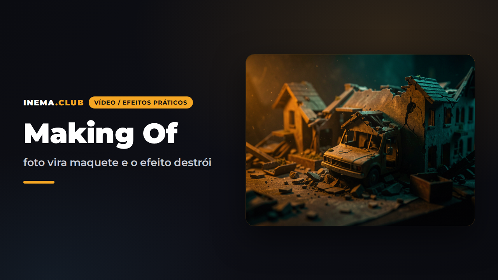
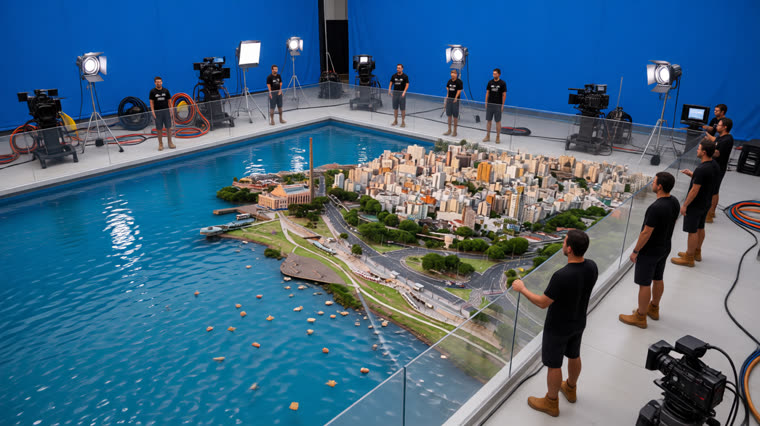
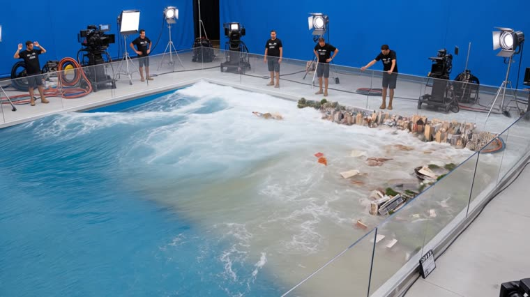

# video-making-of-skill

**🇧🇷 [Português](README.md) · 🇺🇸 [English](README.en.md) · 🇪🇸 [Español](README.es.md)**



## 📖 Guía de uso

Guía completa (landing + paso a paso): **https://linnoff88-dev.github.io/arckhe-/guia/es/**

---

Transforma **una foto de referencia** en un video *behind-the-scenes* ultrarrealista de efecto
práctico: lo que aparece en la foto se convierte en una **maqueta** dentro de un rig de estudio (tanque de olas, mesa sísmica, barras de fuego…), y el efecto destruye la maqueta mientras el equipo filma desde lejos.

| keyframe A — la maqueta montada | el resultado — la ola destruyendo |
|---|---|
|  |  |

Los dos clips que funcionaron, ambos de 15s a partir de la misma foto — [receta B](guia/assets/b-kling.mp4)
(plano único, fiel a la guía) y [variante v2](guia/assets/v2-kling.mp4) (multi-shot con revelación del estudio).
Míralos en la [guía](https://linnoff88-dev.github.io/arckhe-/guia/es/#video).

Basado en la guía AVCC de destrucción de miniaturas en tanque de olas (`doc/`), corregida según lo
que se **midió** al generar ~15 clips reales en dos proveedores.

## El descubrimiento central

> El generador de video tiene que recibir la **maqueta ya montada** como primer frame — no la foto
> de referencia.

Prueba controlada, mismo prompt integral de la guía, misma imagen de origen:

| | A — foto cruda | B — maqueta como frame inicial |
|---|---|---|
| apertura | la ciudad real, intacta | estudio, maqueta fiel |
| destrucción | los edificios **se disuelven en el lugar**, en cubos | los edificios **se rompen** y son arrastrados |
| ola | ninguna | viene del lado del agua abierta, atraviesa lateralmente |
| final | tanque vacío (sin mostrar nunca la maqueta ni la ola) | base raspada + escombros |

Con la foto cruda, el modelo entiende *"transformar esta foto"*, no *"construir una maqueta de esto"* —
y ni siquiera el prompt integral con los 15 negativos cambia el resultado. Por eso el pipeline tiene dos etapas.

## Pipeline

```
foto de referencia
   └─ scripts/kf_a.py ──────────────►  kf_a.png   (maqueta montada en el rig — Agnes, US$ 0)
                                          │
                        ┌─────────────────┴─────────────────┐
        scripts/render_kling.sh                  scripts/render_agnes.py
        (Kling v3_0, plano único)                (interpolación de 3 keyframes, US$ 0)
```

```bash
# 1) la maqueta (el --lock lo escribes mirando la foto, en inglés, edificio por edificio)
scripts/kf_a.py doc/poa2.jpg out/kf_a.png --ratio 16x9 --efeito onda \
  --lock "the same orange-brick riverside power-plant hall, the same tall slender chimney, \
          the same white apartment blocks behind the treeline, the same curved promenade"

# 2) la película
scripts/render_kling.sh out/kf_a.png out/filme.mp4 prompts/avcc-ondas-16x9-en.txt
```

## Los dos proveedores

| | Kling (`render_kling.sh`) | Agnes (`render_agnes.py`) |
|---|---|---|
| modelo | `kling-video-v3_0`, suscripción Pro/SVIP | `agnes-video-v2.0` |
| costo | créditos del plan | **US$ 0** |
| modo | image-to-video de 1 frame + texto | solo `mode: keyframes`, **2 a 3 imágenes** |
| audio | nativo, en la misma pasada | no |
| fortaleza | ola con física real, plano continuo | maqueta fiel, iteración económica |
| debilidad | ancla el frame 1 a la imagen proporcionada | interpola = transforma; sin 3.er keyframe la ola desaparece |

Recetas detalladas, con los fallos medidos de cada uno: `doc/receita-kling.md` y
`doc/receita-agnes.md`. La variante con multi-shot y agua en cámara lenta (buena, pero infringe la
guía): `doc/variante-kling-v2.md`.

## Balance honesto

Efecto **ola**, Kling: **2 de 4** imágenes de referencia generaron un buen clip — y solo después de las
correcciones de causalidad, geometría del `kf_a` y alcance de la destrucción (`doc/receita-kling.md`).
Video en **Agnes**: **0 de 5** — acierta los keyframes, no el movimiento (`doc/receita-agnes.md`).
El descubrimiento de las dos etapas de arriba está respaldado por la prueba A vs B; que «la receta entregue un buen clip»
no está garantizado.

## Reglas que costaron caro

- **Prompt siempre en inglés.** En PT, Agnes bloquea prompts legítimos con HTTP 400.
- **Nada de `--tailImage` / A→B puro.** El frame final obligatorio hace que el modelo *transforme* en vez de
  simular: la destrucción llega por detrás y los edificios se disuelven. El costo de quitarlo: el «no queda
  nada» deja de estar garantizado.
- **El agua no se escala.** Decir "miniature" para todo también miniaturiza el agua (espuma de
  bañera). Solo los edificios son maquetas; el agua es una masa real.
- **La geometría manda más que el texto.** «La ola viene del lado del agua abierta» no sirve si el
  `kf_a` muestra la maqueta como una isla rodeada de agua: la ola sale por dos lados. La maqueta tiene que
  llegar hasta un borde, con una franja ancha de agua abierta en un solo lado.
- **Hay que especificar la causalidad.** «Ningún edificio sufre daños hasta que el agua lo toca; el daño aparece
  solo donde el agua ya pasó» — sin esta regla espacial, la destrucción ocurre antes de que llegue la ola.
- **"Scenery" significa el escenario del ESTUDIO**, no la maqueta. Escribir "chunks of handcrafted
  scenery" hizo que el modelo arrastrara cámaras, reflectores y flight cases al agua.
- **"Tank" evoca un tanque de guerra.** Apareció un vehículo blindado en la piscina en dos generaciones
  seguidas. Usa `effects pool` / `water basin`.
- **Kling: siempre `--poll 0` + `query_tasks`.** El sondeo largo falla (3 de 9 jobs) mientras el job
  de pago termina normalmente. Guarda el `generation_id` antes de cualquier parse.

## Skills

Están en `skills/`, dentro de este repo:

- **`making-of-tanque-ondas`** — el caso AVCC: destrucción de maquetas en tanque de olas.
- **`making-of-simulacao`** — genérica: cualquier simulación práctica (fuego, terremoto, explosión,
  nieve, viento) con la misma estructura de dos etapas.

Para instalar en Claude Code, apunta `~/.claude/skills/` hacia ellas mediante symlink — así, al editar
en un lugar, se edita en el otro y la skill nunca queda desincronizada del código que describe:

```bash
ln -s "$PWD/skills/making-of-tanque-ondas" ~/.claude/skills/making-of-tanque-ondas
ln -s "$PWD/skills/making-of-simulacao"    ~/.claude/skills/making-of-simulacao
```

## Requisitos previos

`AGNES_API_KEY` en `~/projetos/agnes-nei/.env` · CLI `kling` con sesión iniciada (`kling who_am_i`) ·
`ffmpeg`/`ffprobe` en el PATH.

## Estructura

```
doc/       guía AVCC original (PT/EN), recetas medidas, fotos de referencia
prompts/   prompts listos, en inglés, validados
scripts/   kf_a.py · render_kling.sh · render_agnes.py
skills/    making-of-tanque-ondas · making-of-simulacao
guia/      la página publicada (landing + guía) + assets
