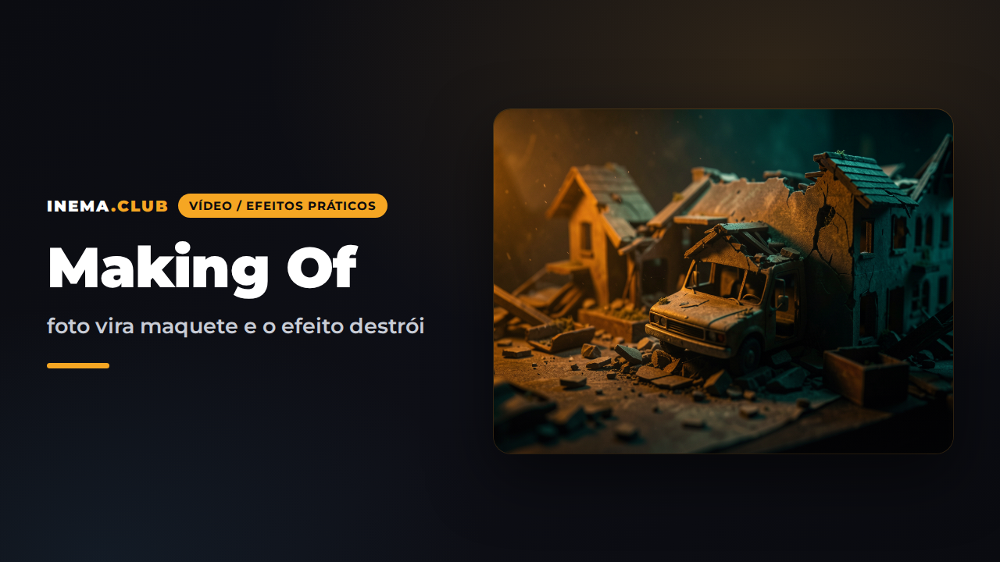
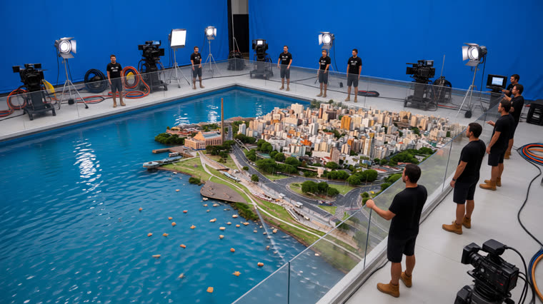
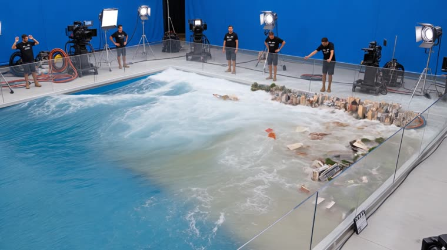

# video-making-of-skill

<div align="center">
  
  <p><strong>Arckhé AI</strong></p>
</div>


**ê°Å¸â€¡Â§ê°Å¸â€¡Â· [PortuguêƒÂªs](README.md) ê‚· ê°Å¸â€¡Âºê°Å¸â€¡Â¸ [English](README.en.md) ê‚· ê°Å¸â€¡Âªê°Å¸â€¡Â¸ [EspaêƒÂ±ol](README.es.md)**



## ê°Å¸â€œâ€“ Guia de uso

Guia completo (landing + passo a passo): **https://inematds.github.io/video-making-of-skill/guia/**

---

Transforma **uma foto de referêƒÂªncia** num vêƒÂ­deo *behind-the-scenes* ultra-realista de efeito
prêƒÂ¡tico: a coisa da foto vira **maquete** dentro de um rig de estêƒÂºdio (tanque de ondas, mesa
sêƒÂ­smica, barras de fogoê¢â‚¬Â¦), e o efeito destrêƒÂ³i a maquete enquanto a equipe filma de longe.

| keyframe A ê¢â‚¬â€ a maquete montada | o resultado ê¢â‚¬â€ a onda destruindo |
|---|---|
|  |  |

Os dois clipes que funcionaram, ambos de 15s a partir da mesma foto ê¢â‚¬â€ [receita B](guia/assets/b-kling.mp4)
(plano êƒÂºnico, fiel ao guia) e [variante v2](guia/assets/v2-kling.mp4) (multi-shot com revelaêƒÂ§êƒÂ£o do estêƒÂºdio).
Assista no [guia](https://inematds.github.io/video-making-of-skill/guia/#video).

Baseado no guia AVCC de destruiêƒÂ§êƒÂ£o de miniatura em tanque de ondas (`doc/`), corrigido pelo
que foi **medido** gerando ~15 clipes reais em dois provedores.

## A descoberta central

> O gerador de vêƒÂ­deo tem que receber a **maquete jêƒÂ¡ montada** como primeiro frame ê¢â‚¬â€ nêƒÂ£o a foto
> de referêƒÂªncia.

Teste controlado, mesmo prompt integral do guia, mesma imagem de origem:

| | A ê¢â‚¬â€ foto crua | B ê¢â‚¬â€ maquete como frame inicial |
|---|---|---|
| abertura | a cidade real, intacta | estêƒÂºdio, maquete fiel |
| destruiêƒÂ§êƒÂ£o | prêƒÂ©dios **se dissolvem no lugar**, em cubos | prêƒÂ©dios **quebram** e sêƒÂ£o arrastados |
| onda | nenhuma | vem do lado da êƒÂ¡gua aberta, atravessa lateralmente |
| final | tanque vazio (sem nunca mostrar maquete nem onda) | base raspada + destroêƒÂ§os |

Com a foto crua o modelo entende *"transformar esta foto"*, nêƒÂ£o *"construir uma maquete disto"* ê¢â‚¬â€
e nem o prompt integral com os 15 negativos vira esse jogo. Por isso o pipeline tem duas etapas.

## Pipeline

```
foto de referêƒÂªncia
   ê¢â€â€ê¢â€â‚¬ scripts/kf_a.py ê¢â€â‚¬ê¢â€â‚¬ê¢â€â‚¬ê¢â€â‚¬ê¢â€â‚¬ê¢â€â‚¬ê¢â€â‚¬ê¢â€â‚¬ê¢â€â‚¬ê¢â€â‚¬ê¢â€â‚¬ê¢â€â‚¬ê¢â€â‚¬ê¢â€â‚¬ê¢â€“º  kf_a.png   (maquete montada no rig ê¢â‚¬â€ Agnes, US$ 0)
                                          ê¢â€â€š
                        ê¢â€Å’ê¢â€â‚¬ê¢â€â‚¬ê¢â€â‚¬ê¢â€â‚¬ê¢â€â‚¬ê¢â€â‚¬ê¢â€â‚¬ê¢â€â‚¬ê¢â€â‚¬ê¢â€â‚¬ê¢â€â‚¬ê¢â€â‚¬ê¢â€â‚¬ê¢â€â‚¬ê¢â€â‚¬ê¢â€â‚¬ê¢â€â‚¬ê¢â€Â´ê¢â€â‚¬ê¢â€â‚¬ê¢â€â‚¬ê¢â€â‚¬ê¢â€â‚¬ê¢â€â‚¬ê¢â€â‚¬ê¢â€â‚¬ê¢â€â‚¬ê¢â€â‚¬ê¢â€â‚¬ê¢â€â‚¬ê¢â€â‚¬ê¢â€â‚¬ê¢â€â‚¬ê¢â€â‚¬ê¢â€â‚¬ê¢â€Â
        scripts/render_kling.sh                  scripts/render_agnes.py
        (Kling v3_0, plano êƒÂºnico)                (interpolaêƒÂ§êƒÂ£o 3 keyframes, US$ 0)
```

```bash
# 1) a maquete (o --lock vocêƒÂª escreve olhando a foto, em inglêƒÂªs, prêƒÂ©dio a prêƒÂ©dio)
scripts/kf_a.py doc/poa2.jpg out/kf_a.png --ratio 16x9 --efeito onda \
  --lock "the same orange-brick riverside power-plant hall, the same tall slender chimney, \
          the same white apartment blocks behind the treeline, the same curved promenade"

# 2) o filme
scripts/render_kling.sh out/kf_a.png out/filme.mp4 prompts/avcc-ondas-16x9-en.txt
```

## Os dois provedores

| | Kling (`render_kling.sh`) | Agnes (`render_agnes.py`) |
|---|---|---|
| modelo | `kling-video-v3_0`, assinatura Pro/SVIP | `agnes-video-v2.0` |
| custo | crêƒÂ©ditos do plano | **US$ 0** |
| modo | image-to-video de 1 frame + texto | sêƒÂ³ `mode: keyframes`, **2 a 3 imagens** |
| êƒÂ¡udio | nativo, no mesmo passe | nêƒÂ£o |
| forêƒÂ§a | onda com fêƒÂ­sica de verdade, plano contêƒÂ­nuo | maquete fiel, iteraêƒÂ§êƒÂ£o barata |
| fraqueza | ancora o frame 1 na imagem dada | interpola = morfa; sem 3ꂺ keyframe a onda some |

Receitas detalhadas, com as falhas medidas de cada um: `doc/receita-kling.md` e
`doc/receita-agnes.md`. A variante com multi-shot e êƒÂ¡gua em slow motion (boa, mas viola o
guia): `doc/variante-kling-v2.md`.

## Placar honesto

Efeito **onda**, Kling: **2 de 4** imagens de referêƒÂªncia renderizaram um clipe bom ê¢â‚¬â€ e sêƒÂ³ depois das
correêƒÂ§êƒÂµes de causalidade, geometria do `kf_a` e escopo da destruiêƒÂ§êƒÂ£o (`doc/receita-kling.md`).
VêƒÂ­deo na **Agnes**: **0 de 5** ê¢â‚¬â€ ela acerta os keyframes, nêƒÂ£o o movimento (`doc/receita-agnes.md`).
A descoberta dos dois estêƒÂ¡gios acima estêƒÂ¡ sustentada pelo teste A vs B; "a receita entrega um clipe
bom" nêƒÂ£o êƒÂ© garantido.

## Regras que custaram caro

- **Prompt sempre em inglêƒÂªs.** Em PT a Agnes bloqueia prompt legêƒÂ­timo com HTTP 400.
- **Nada de `--tailImage` / Aê¢â€ â€™B puro.** Frame final obrigatêƒÂ³rio faz o modelo *morfar* em vez de
  simular: a destruiêƒÂ§êƒÂ£o chega por trêƒÂ¡s e os prêƒÂ©dios se dissolvem. Custo de tirar: o "nada resta"
  deixa de ser garantido.
- **A êƒÂ¡gua nêƒÂ£o escala.** Dizer "miniature" para tudo miniaturiza tambêƒÂ©m a êƒÂ¡gua (espuma de
  banheira). SêƒÂ³ os prêƒÂ©dios sêƒÂ£o maquete; a êƒÂ¡gua êƒÂ© massa real.
- **A geometria manda mais que o texto.** "A onda vem do lado da êƒÂ¡gua aberta" nêƒÂ£o adianta se o
  `kf_a` mostra a maquete como ilha cercada de êƒÂ¡gua: sai onda de dois lados. A maquete tem que
  encostar em uma borda, com uma faixa larga de êƒÂ¡gua aberta num lado sêƒÂ³.
- **Causalidade tem que ser dita.** "Nenhum prêƒÂ©dio êƒÂ© danificado atêƒÂ© a êƒÂ¡gua tocêƒÂ¡-lo; o dano aparece
  sêƒÂ³ onde a êƒÂ¡gua jêƒÂ¡ passou" ê¢â‚¬â€ sem essa regra espacial a destruiêƒÂ§êƒÂ£o acontece antes da onda chegar.
- **"Scenery" significa o cenêƒÂ¡rio do ESTêƒÅ¡DIO**, nêƒÂ£o a maquete. Escrever "chunks of handcrafted
  scenery" fez o modelo arrastar cêƒÂ¢meras, refletores e flight cases para dentro da êƒÂ¡gua.
- **"Tank" convoca um tanque de guerra.** Apareceu um blindado na piscina em duas geraêƒÂ§êƒÂµes
  seguidas. Use `effects pool` / `water basin`.
- **Kling: sempre `--poll 0` + `query_tasks`.** O poll longo cai (3 de 9 jobs) enquanto o job
  pago termina normal. Grave o `generation_id` antes de qualquer parse.

## Skills

Vivem em `skills/`, dentro deste repo:

- **`making-of-tanque-ondas`** ê¢â‚¬â€ o caso AVCC: destruiêƒÂ§êƒÂ£o de maquete em tanque de ondas.
- **`making-of-simulacao`** ê¢â‚¬â€ genêƒÂ©rica: qualquer simulaêƒÂ§êƒÂ£o prêƒÂ¡tica (fogo, terremoto, explosêƒÂ£o,
  neve, vento) com a mesma estrutura de dois estêƒÂ¡gios.

Para instalar no Claude Code, aponte `~/.claude/skills/` para elas por symlink ê¢â‚¬â€ assim editar
num lugar edita no outro e a skill nunca sai de sincronia com o cêƒÂ³digo que ela descreve:

```bash
ln -s "$PWD/skills/making-of-tanque-ondas" ~/.claude/skills/making-of-tanque-ondas
ln -s "$PWD/skills/making-of-simulacao"    ~/.claude/skills/making-of-simulacao
```

## PrêƒÂ©-requisitos

`AGNES_API_KEY` em `~/projetos/agnes-nei/.env` ê‚· CLI `kling` logado (`kling who_am_i`) ê‚·
`ffmpeg`/`ffprobe` no PATH.

## Estrutura

```
doc/       guia AVCC original (PT/EN), receitas medidas, fotos de referêƒÂªncia
prompts/   prompts prontos, em inglêƒÂªs, validados
scripts/   kf_a.py ê‚· render_kling.sh ê‚· render_agnes.py
skills/    making-of-tanque-ondas ê‚· making-of-simulacao
guia/      a pêƒÂ¡gina publicada (landing + guia) + assets
```

---

<div align="center">
  
  <p><strong>Arckhé AI</strong></p>
</div>